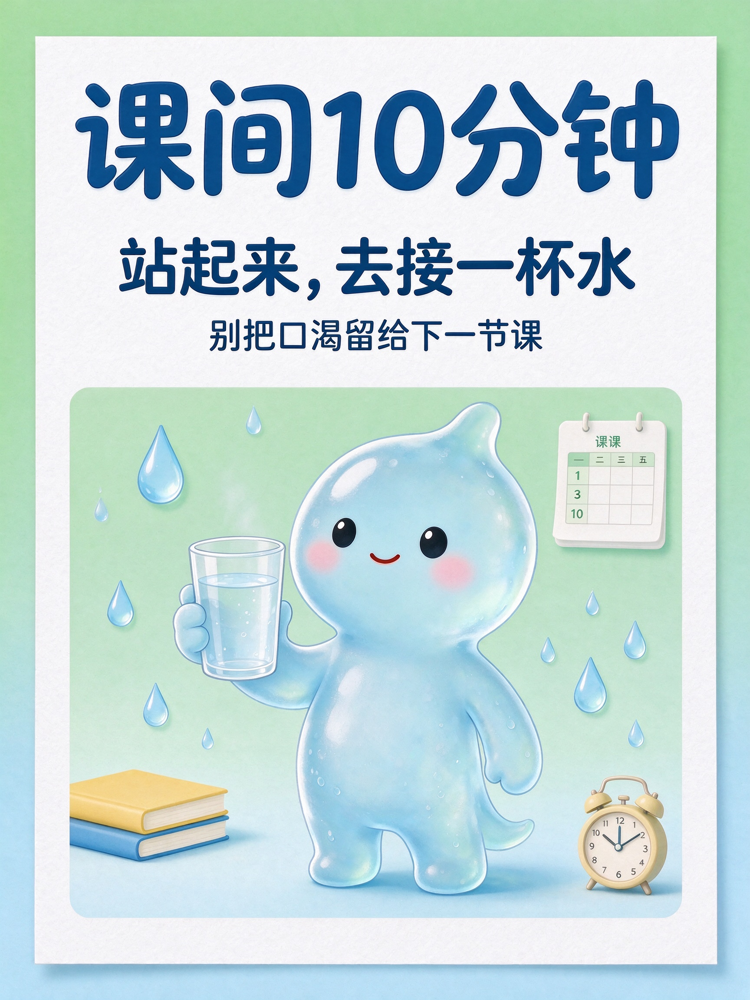
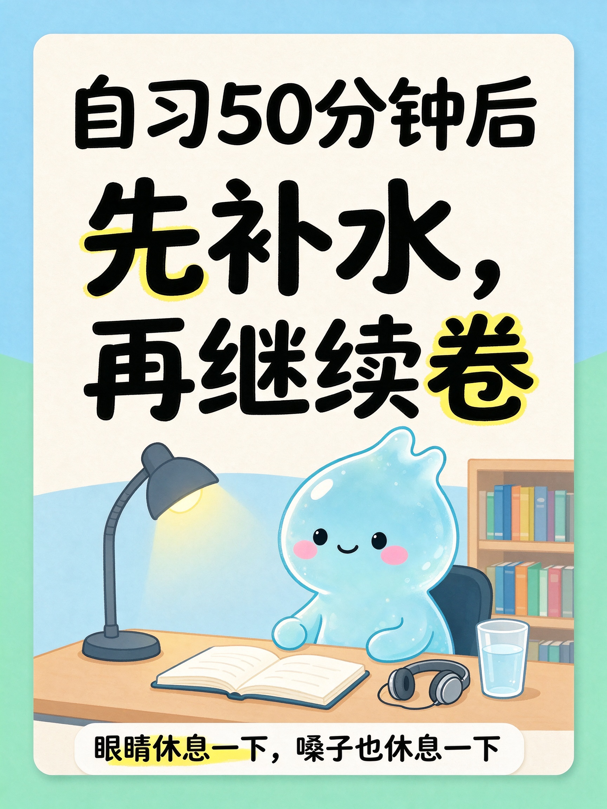
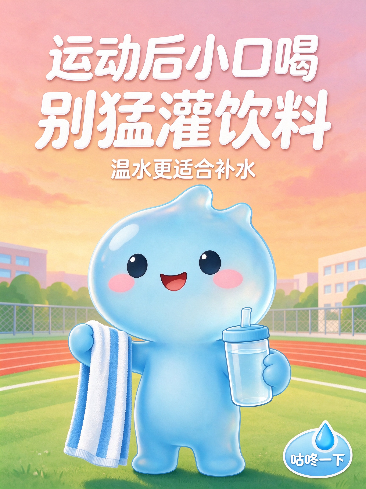
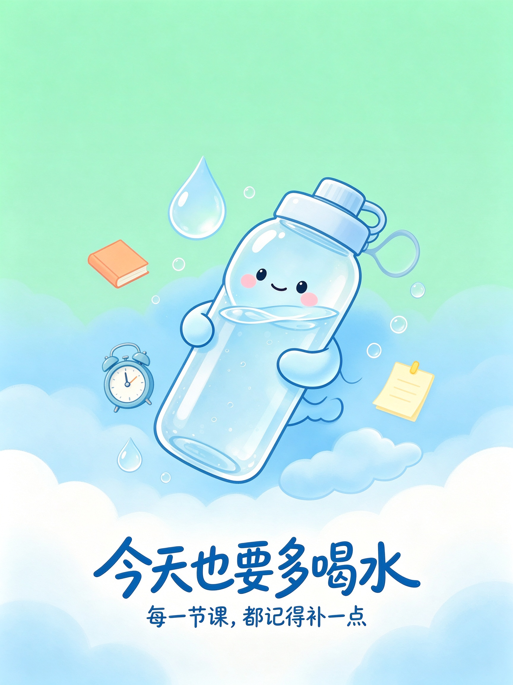
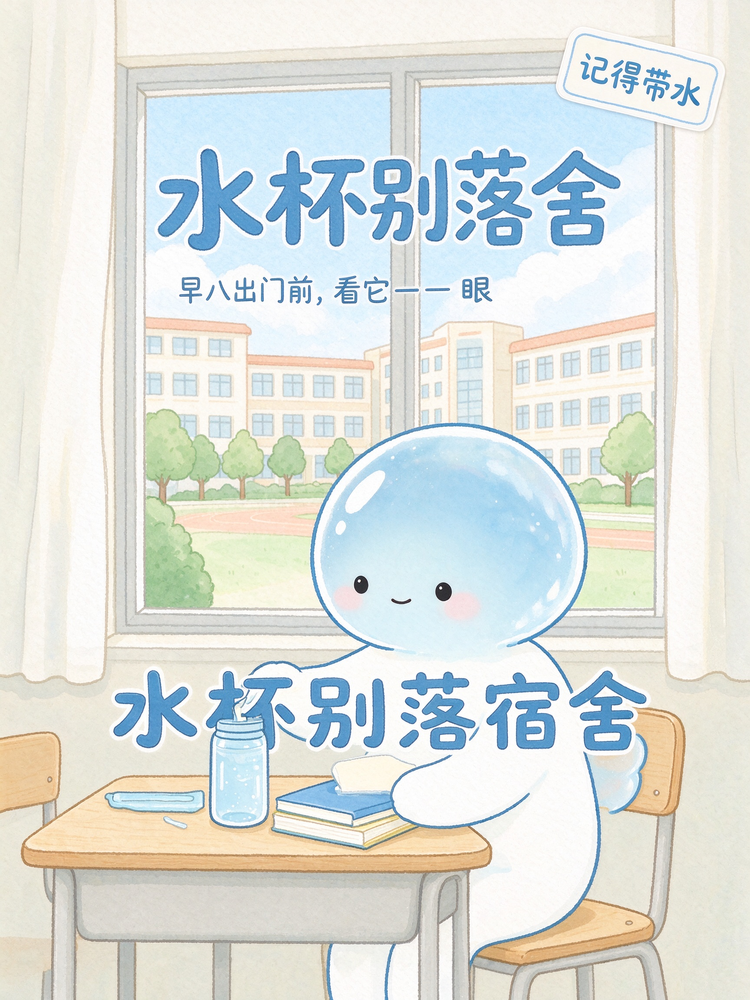
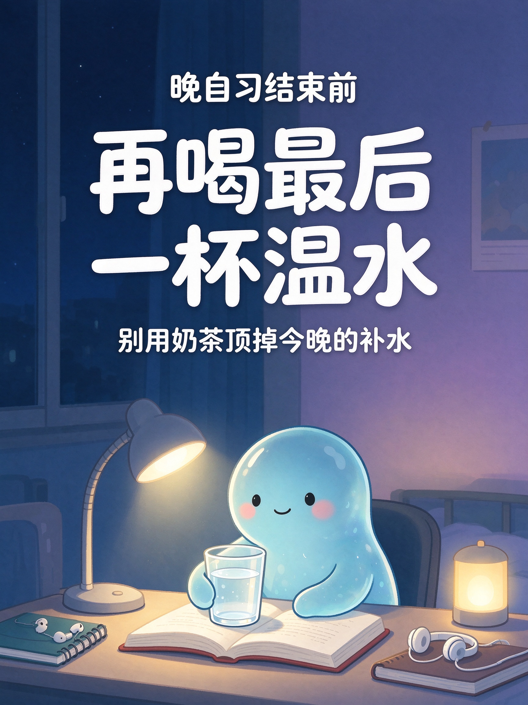

# AIGC 提醒素材包 · 校园喝水提醒

> **所属**：豆包（AIGC 助手）
> **分支**：`豆包-AIGC提醒素材包`
> **面向用户**：中学生 / 大学生　**场景**：校园（教室、图书馆、宿舍、操场、食堂、晚自习）
> **内容**：AIGC 生成的提醒文案库 + 提醒卡片 + 手机壁纸，供「咕咚校园」喝水提醒项目直接取用。

## 本分支内容清单

```
AIGC提醒素材包/
├── README.md                     ← 本说明
├── 文案库/
│   └── 提醒文案库.md             ← 三个人设 × 8 个校园场景提醒文案 + AIGC 生成提示词模板
├── 提醒卡片/                     ← 可发班级群 / 朋友圈的竖版提醒图（1728×2304）
│   ├── 01-课间10分钟-站起来接杯水.jpg
│   ├── 02-自习50分钟-先补水再继续卷.jpg
│   └── 03-运动后小口喝-别猛灌饮料.jpg
└── 手机壁纸/                     ← 可直接设为锁屏 / 桌面的竖版壁纸
    ├── 01-今天也要多喝水.jpg
    ├── 02-水杯别落宿舍-早八带水.jpg
    └── 03-晚自习最后一杯温水.jpg
```

## 提醒卡片预览

| 课间 10 分钟 | 自习 50 分钟 | 运动后 |
|---|---|---|
|  |  |  |

## 手机壁纸预览

| 日常补水 | 早八带水 | 晚自习收尾 |
|---|---|---|
|  |  |  |

## 设计说明

- **统一 IP**：软萌蓝色水精灵「咕咚」，薄荷绿 / 浅蓝 / 暖橙配色，贴近学生审美。
- **三档人设文案**：学霸同桌（理性鼓励）、吐槽搭子（毒舌暖心）、软萌水精灵（可爱陪伴），可按用户偏好切换语气。
- **素材可复用**：文案库内附 AIGC 提示词模板，可无限批量生成新话术；图片为 AIGC 生成，可二次改字复用。

## 在整合项目中的位置

本目录是「咕咚校园」的内容素材层，供手机端小程序（`小程序原型/`）与桌面端（`喝水提醒/`）取用：
文案库可作为提醒话术来源，卡片 / 壁纸可用于校园推广与打卡活动。
