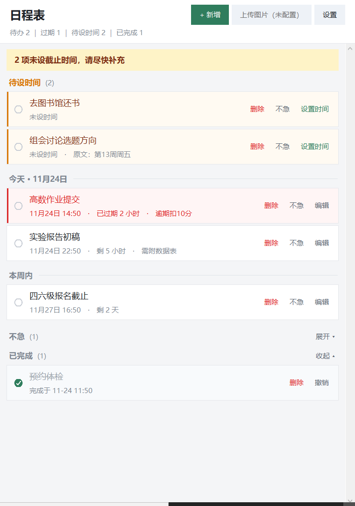
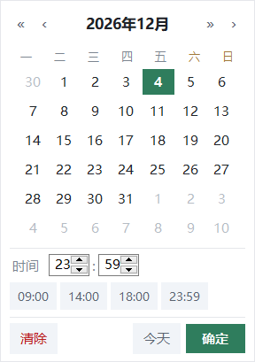

# 日程表

`xnians_drinking` 项目下的日程表模块，开发分支：`laj/日程表`。

> 本分支为独立根提交（orphan），不包含 `喝水提醒` 的代码与历史，只存放日程表相关的内容。

把截图里的时间信息变成一份会自动排序、会催你补截止时间的日程清单。



| 日历式选择时间 | 识别结果逐条确认 |
| --- | --- |
|  |  |

## 快速开始

| 文件 | 说明 |
| --- | --- |
| `启动日程表.vbs` | **推荐**：后台启动，不弹控制台（路径按脚本自身位置解析，换机器不用改） |
| `启动日程表.bat` | 备选，需要 `pythonw` 在 PATH 中 |
| `app.py` | 程序本体，也可 `python app.py` 调试运行 |
| `datepicker.py` | 日历选择控件（自绘，替代 GPL 的 tkcalendar） |

需要 Python 3.8+（官方安装包自带 tkinter）。除可选的 Pillow（图片压缩）外**无第三方依赖**。

## 功能

### 1. 分区规则（本项目的核心）

存储只记三种状态（`pending` / `someday` / `done`），界面上的五种呈现由规则推导——"过期"不需要定时任务去刷，打开程序算一遍就对。

| 状态 | 判定 | 位置 | 视觉 |
| --- | --- | --- | --- |
| 待设时间 | 待办且无截止时间 | 主列表**最顶部**，独立橙块 | 橙条 + 浅橙底 + 顶部警示横幅 |
| 进行中 | 待办且有未来截止时间 | 按截止时间升序 | 正常黑字 + "剩 N 天/小时" |
| 已过期 | 待办且已过截止时间 | **留在原位**（不单独设区） | 整行红字 + 左侧红条 + "已过期 N 小时" |
| 不急 | 用户**手动**点标记 | 独立折叠区 | 蓝灰弱化 |
| 已完成 | 点圆圈打勾 | 独立折叠区 | 灰色 + 删除线 |

### 2. 打勾动画

18px 空心圆 → 悬停描边 → 点击后 120ms 填充 + 对勾 5 帧描线 + 140ms 停顿 → 移入已完成区。全过程约 500ms，期间该行不可重复点击。

### 3. 图片录入

- 设置面板里**人工填写**接口地址、模型名、API Key（不硬编码、不读环境变量）
- 「测试连接」会发一张写着 `42` 的小图，模型能复述出来才算通过——只 ping 不测图的话，**纯文本模型会假装连通**（实测 `deepseek-v4-flash` 就是这样：图传进去返回空数组）
- 上传图片 → 多模态模型提取 → 逐条确认（标题可改、时间点日历选）→ 入库
- 识别不出来时**不猜**：`due` 留空、原文存进 `due_hint`，该条自动落入「待设时间」区由人补
- 能算准的在**本地算**（`rules.resolve_text_due`，不交给模型）：`12月8日` → 今年这一天；**今年已经过了就顺延到明年**（11 月贴的「1月5日」= 明年 1 月 5 日）；`周五`／`下周三` → 最近的下一个该星期几（已过就推到下周同一天）；只给日期不给钟点补 `23:59`。**「第13周」这类周次仍不换算**，留原文给人工
- 确认框里**默认全勾**；置信度 < 0.6 的条目标红「把握较低，请核对」，但不替用户做丢弃决定
- 未配置接口时「上传图片」置灰，手动录入完全不受影响

能看图的模型（实测）：`qwen3-vl-plus`（7.2s / 4 条全中）、`qwen3.7-flash`（17.2s / 4 条全中，标题略短）。纯文本模型（`deepseek-v4-flash`、`qwen-plus` 等）识别结果恒为空。

### 4. 手动录入

标题必填，截止时间**点日历选**：月历（周一起始，跨月灰显，今天浅绿，选中填绿）+ 时/分步进 + 09:00 / 14:00 / 18:00 / 23:59 四个快捷时刻。可以不选时间——存完自动进「待设时间」区置顶提醒。可直接标记「不急」。

## 目录

```
日程表/
├── app.py              # 主窗口、对话框、打勾动画
├── datepicker.py       # 日历选择控件（自绘月历 + 时分步进）
├── rules.py            # 分区与排序（纯函数，可单测）
├── store.py            # data.json 原子读写
├── parser.py           # 图片 → 日程草稿（多模态接口）
├── tests/test_rules.py # 18 个边界用例
├── 策划案.md            # 项目策划案（功能规则、技术方案、AI 开发规则）
├── CREDITS.md          # 开源参考与许可证核查
├── 预览图/             # 主界面、新增日程、日历选择、识别确认
├── 启动日程表.vbs
├── 启动日程表.bat
└── .gitignore
```

数据存在同目录 `data.json`（含 API Key，已加入 `.gitignore`），原图存在 `images/`。

## 测试

```bash
python -m unittest discover -s tests -v
```

覆盖：五种状态判定、正好到点算过期、无时间置顶排序、时间线合并升序、已完成倒序、分组标题、撤销后保留原截止时间。

## 说明

- 分支：`laj/日程表`（本地目录 `生成式人工智能/日程表` 与分支内容一一对应）
- 提交作者：`林铵杰 <yuly372@163.com>`
